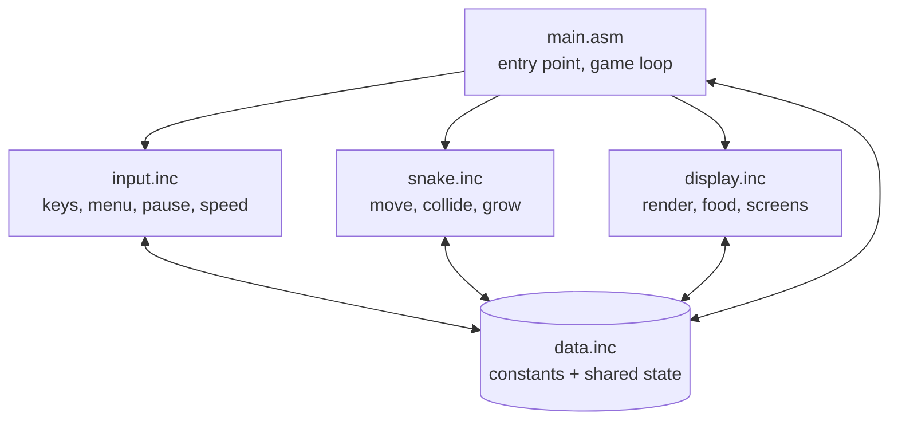
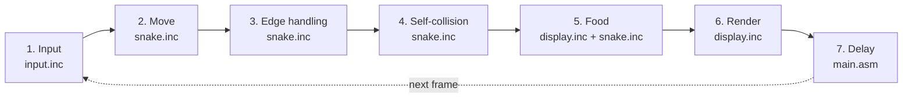

# Snake-Game_x86: Architecture

Console Snake in x86 assembly (MASM, Irvine32) for the Windows console.
Playfield is 40x20. Speed rises with score. Game ends on self-collision, or on a win at maximum length.

## Modules

| File | Responsibility |
|---|---|
| `main.asm` | Entry point and game loop |
| `data.inc` | Constants and shared state |
| `input.inc` | Input, pause, quit, restart, speed, menu handling |
| `snake.inc` | Movement, edge handling, collision, growth |
| `display.inc` | Rendering, food, menu and status screens, game over |

## Module diagram

## Key rule: shared state, not registers

Modules do not pass values through registers. They read and write shared variables defined in `data.inc`.
Because of this, **every procedure must save and restore any register it uses** (`pushad` / `popad`).

## Frame order (fixed)

Do not reorder these stages. For example, edge handling must run before the collision check.

## Game modes

| Mode | Behavior |
|---|---|
| Walls enabled | Touching the border ends the game |
| Walls disabled | Snake wraps to the opposite side |

Self-collision ends the game in both modes.

## Suggested shared state in `data.inc`

Final names are decided on day 1 by all three. Starting list:

| Group | Variables |
|---|---|
| Constants | `FIELD_W = 40`, `FIELD_H = 20`, `MAX_LEN`, `BASE_DELAY`, `MIN_DELAY` |
| Snake | `snakeX[]`, `snakeY[]`, `snakeLen`, `direction`, `nextDirection` |
| Food | `foodX`, `foodY`, `foodEaten` flag |
| Game | `score`, `delayMs`, `wallsEnabled`, `gameState` (menu / running / paused / over / won) |
| Flags | `quitRequested`, `restartRequested`, `collisionFlag` |

## Controls

| Key | Action |
|---|---|
| W / A / S / D or arrow keys | Steer |
| P | Pause / resume |
| Q | Quit |
